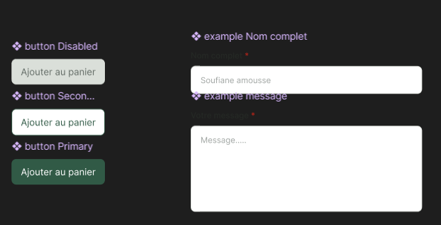
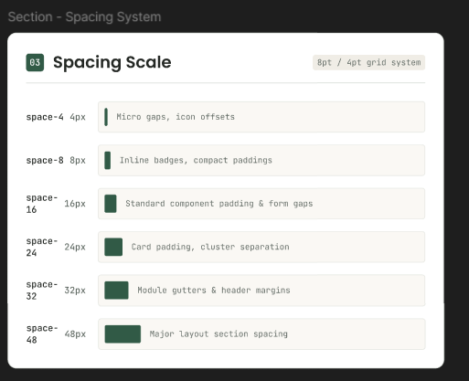
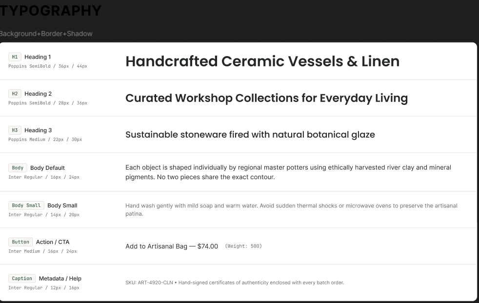

# Boutique e-commerce artsanale (groupe project)
Ce site web est un projet prédagogique de création d'une boutique e-commerce dédie aux produits artisanaux.
L'objectif est de concevoir une interface moderne, accessible et responsive,permettent aux visiteurs de découvrir des produits , de consulter leurs détails, de gérer visuellement leur panier et de contacter la boutique.

Le site est développé  selon une approche mobile-first. Il s'agit d'une intégration front-end uniquement

## Les outils utilisés:
-HTML5
-Tailwind CSS
-Figma
-npm
-Git et Github

## Structure du site web:
-Accueil : présentation de la boutique, catégories et produits vedettes.

-Catalogue : grille de produits, filtres statiques et pagination statique.

-Fiche produit : galerie d'images, description, prix et choix de quantité.

-Panier : affichage des articles, quantités et récapitulatif de commande statique.

-Contact : formulaire de contact, coordonnées et horaires d'assistance.

## La bibliothèque de composants:
réaliser par Mr. SOUFIANE 

 
 ## lien Figme:
 [lien figma]
(https://www.figma.com/design/8Cv4Nd4jvlSk5YNA7Iipep/E-commerce?node-id=0-1&t=YbUPRkIZXpf3PLjV-1)

## Membres de l'équipe:
-MAKHFI AYA 
-CHARAFI MEHDI
-Youssef Boukacha

